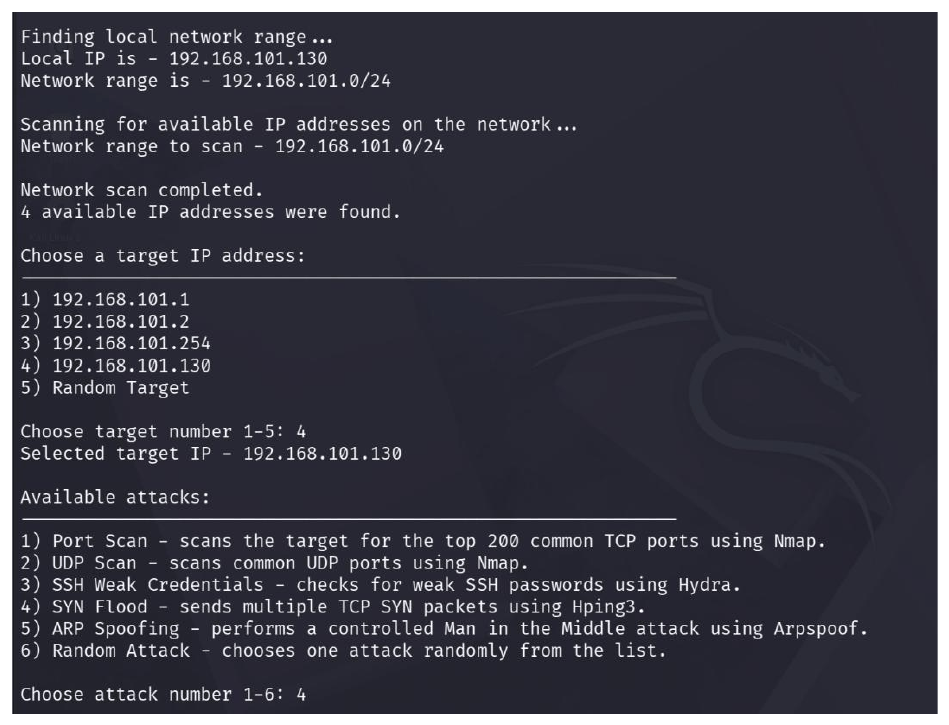
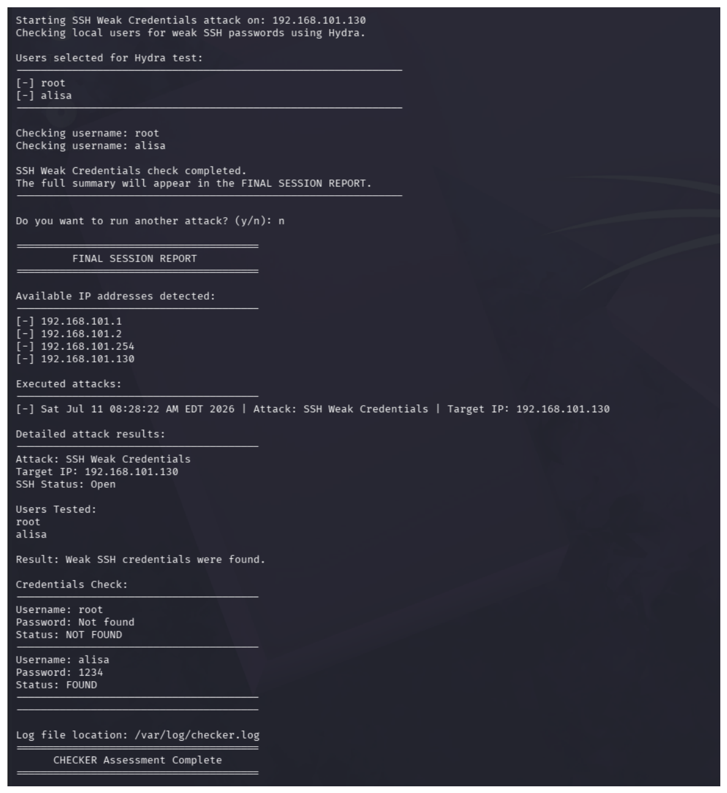
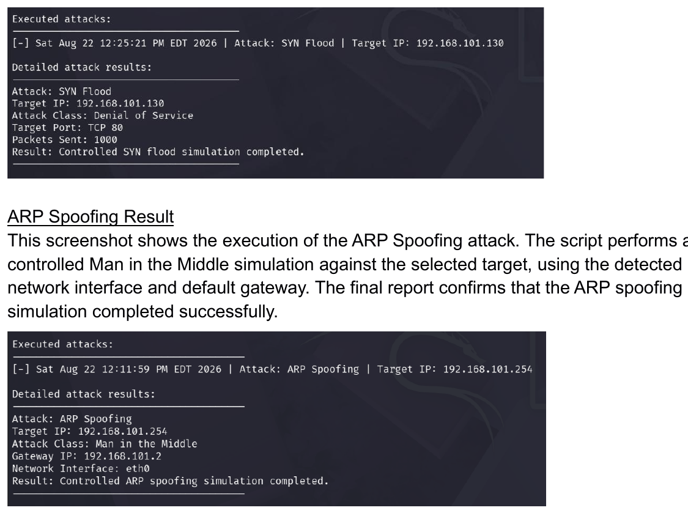
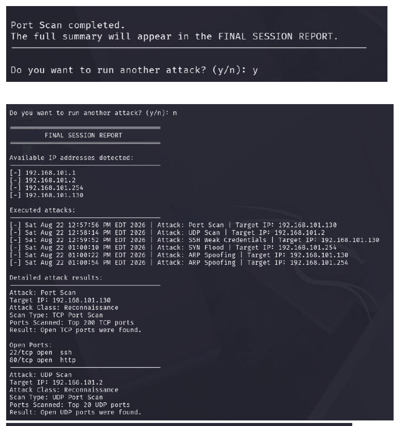
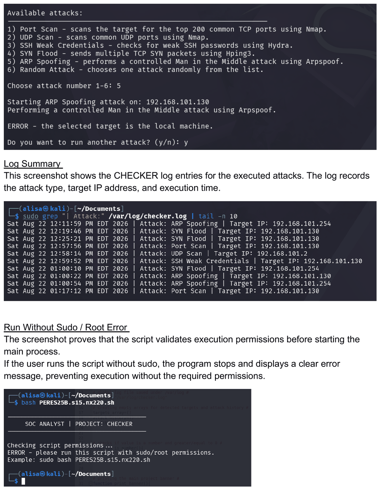

# CHECKER — Attack Simulation & Activity Logging

> A menu-driven Bash tool that discovers hosts on the local network, runs one of five controlled security operations against a selected target, and records every executed action to a log file for later review.

**Context:** Cybersecurity specialization project — SOC Analyst module (Cyberium Arena / ThinkCyber) · **Author:** Alisiya Rabinovich · **Language:** Bash

---

## Overview

CHECKER is a lab-oriented **attack simulation and activity-logging tool**. It is not a SOC monitoring platform and performs no threat detection of its own — instead, it *generates* a set of controlled, repeatable, and logged attack activities on a test network, so that the resulting activity and its log trail can be examined afterward.

The script auto-discovers active hosts, lets the user pick a target and one of five operations (or a random one), executes it, and appends a timestamped record to `/var/log/checker.log`. After each run the user can launch another operation in the same session, and a final report summarizes everything that was done.

## Problem & objectives

- Provide a single, repeatable way to produce several classes of network attack activity in a controlled lab.
- Make every action **auditable**: record attack type, timestamp, target IP, and full technical output.
- Keep the workflow menu-driven and validated so runs are consistent and easy to repeat.

## Technologies used

| Tool | Role in the project |
|------|---------------------|
| **Nmap** | Host discovery (`-sn` ping sweep), TCP/UDP port scans, SSH port check |
| **Hydra** | SSH weak-credential testing against a generated password list |
| **Hping3** | Bounded TCP SYN packet burst (denial-of-service simulation) |
| **Arpspoof** (`dsniff`) | Controlled ARP man-in-the-middle simulation |
| **Bash** | Orchestration, input validation, logging, reporting |

## The five operations

Each operation is implemented as its own function and maps to one of four attack classes:

| # | Operation | Class | Tool | What it does |
|---|-----------|-------|------|--------------|
| 1 | TCP Port Scan | Reconnaissance | Nmap | Scans the top 200 TCP ports (`-Pn --top-ports 200`); extracts open ports |
| 2 | UDP Scan | Reconnaissance | Nmap | Scans the top 20 UDP ports (`-sU --top-ports 20`) |
| 3 | SSH Weak Credentials | Credential Attack | Nmap + Hydra | Confirms port 22 is open, collects local usernames from `/etc/passwd`, then tests them with Hydra against a generated weak-password list |
| 4 | SYN Flood | Denial of Service | Hping3 | Sends a fixed burst of 1000 TCP SYN packets to port 80 (`-S -c 1000 -i u1000`) |
| 5 | ARP Spoofing | Man in the Middle | Arpspoof | Runs a time-limited (~8s) bidirectional ARP spoof between the target and the gateway |

A sixth menu entry ("Random Attack") simply selects one of the five at random.

## Key features

- **Automatic host discovery** — detects the local IP, derives a `/24` range, and ping-sweeps it with Nmap; no manual IP entry.
- **Manual or random selection** of both target and operation.
- **Multiple operations per session** — a loop lets the user keep running operations until they choose to stop.
- **Full logging** to `/var/log/checker.log`: a timestamped session header, then per-operation records with attack type, time, target, and complete technical output.
- **Final session report** — detected hosts, the list of executed operations, clean per-operation summaries, and the log path.
- **Input validation** — non-numeric or out-of-range target/operation choices print an error and terminate the program.

## Operational workflow

1. **Root check** — the script exits unless run as root (required to write under `/var/log` and to run privileged scans/tools).
2. **Dependency check** — verifies Nmap, Hydra, Hping3, and Arpspoof; offers to install any that are missing.
3. **Log preparation** — creates/opens `/var/log/checker.log` and writes a timestamped session header.
4. **Network range detection** — resolves the local IP and builds the `/24` range.
5. **Host discovery** — Nmap ping-sweeps the range; detected hosts are stored and displayed.
6. **Target selection** — a specific host or a random one.
7. **Operation selection** — one of the five operations or a random one.
8. **Execution** — the chosen function runs and logs its result.
9. **Loop / report** — run another operation, or print the final session report.

## Technical decisions & limitations

These are accurate descriptions of what the code does — and does not — guarantee:

- **ARP-spoofing safeguards.** Before spoofing, the function refuses to run if the selected target is the local machine or the default gateway, and it saves the current `ip_forward` value. In the **normal completion path**, after the two time-limited `arpspoof` processes finish, the script restores the original IP-forwarding setting. This restoration runs on normal completion; it is **not guaranteed** if the script is killed or interrupted abnormally mid-run (e.g. `SIGKILL`), which would leave IP forwarding enabled.
- **Bounded SYN flood.** The SYN burst is fixed at 1000 packets to TCP port 80. This bounds the volume compared with an open-ended flood, but it is still a denial-of-service action and should only ever target a host you are authorized to test in an isolated lab. It is not inherently "safe."
- **Conditional credential testing.** Hydra only runs after Nmap confirms port 22 is open; otherwise the operation is skipped and recorded as such.
- **Credential source.** The SSH operation builds its username list from the local machine's `/etc/passwd` (root plus UID ≥ 1000 interactive accounts) and tests them against a short weak-password list generated at runtime. It is a demonstration against lab accounts, not a general-purpose cracker.
- **No detection claims.** CHECKER generates and logs activity. It does not claim to detect, alert on, or measure the detectability of that activity in any real SOC tooling.

## Requirements & Execution

**Environment.** Linux, developed and tested on **Kali Linux** (which ships with all the required tools). Any Debian-based distribution with the tools below should work.

**Dependencies (from the source).** `nmap`, `hydra`, `hping3`, and `arpspoof` (provided by the `dsniff` package). On startup the script checks for each and, if one is missing, offers to install it via `apt`.

**Root privileges — required.** CHECKER **must** run as root: `check_root` exits immediately if the effective user is not root. Elevation is needed to write the log under `/var/log/checker.log` and to run the privileged operations (raw SYN packets via Hping3, ARP spoofing via Arpspoof).

**Execution command:**

```bash
sudo bash checker.sh
```

Then follow the interactive menu: the script discovers hosts, you choose a target and an operation, and results are written to `/var/log/checker.log` and summarized in the final report.

**Elevated-privilege behavior to be aware of.** Run with `sudo`, this script may **install packages** (`apt install`) and performs **privileged network operations** — a bounded SYN packet burst and a bidirectional ARP spoof — against the target you select. Review the source before running it with `sudo`, and run it **only in an explicitly authorized lab environment** on a network you control.

## Screenshots & demonstrated results

All screenshots are from the project's own lab runs on a private (RFC1918) test network. Credentials shown are deliberately weak **lab demonstration** accounts, preserved as evidence of functionality.

**Startup, host discovery, and the five-operation menu**


**SSH weak-credential testing (lab result)**


**SYN Flood and ARP Spoofing results**


**Multiple operations in one session**


**Log entries and permission validation**


## Project report

The full original project report (cleaned of academic identifiers) is included: [checker-project-report.pdf](docs/checker-project-report.pdf).

## Technical and Design Takeaways

- **Modular Bash automation** — each operation is a self-contained function behind a single dispatch/menu loop, which keeps the five very different actions readable and independently maintainable.
- **Integrating multiple command-line tools** — the script coordinates Nmap, Hydra, Hping3, and Arpspoof through a consistent interface, parsing each tool's output into a uniform per-operation report.
- **Input validation and safe-guarding logic** — menu choices are validated and bounded, and the ARP operation includes explicit guards (local/gateway checks, state save/restore) that reflect deliberate thinking about side effects.
- **Structured logging and reporting** — every action produces both a full technical log entry and a clean summary, demonstrating a logging-and-reporting design that separates raw output from a human-readable report.

Beyond the cybersecurity domain, the transferable skills here are the ones that apply to most technical work: breaking a process into modular, single-responsibility components; integrating and orchestrating external tools behind one interface; validating input and guarding against side effects; and producing clear, structured, auditable output.

## Educational use & authorization

This tool was built and run in an **authorized educational laboratory environment** for learning purposes. Its scope restrictions and bounded operations are technical controls, **not** a substitute for authorization. Do not run it against any system, network, or device you are not explicitly authorized to test. Unauthorized scanning, credential testing, denial-of-service, or man-in-the-middle activity is illegal in most jurisdictions.
