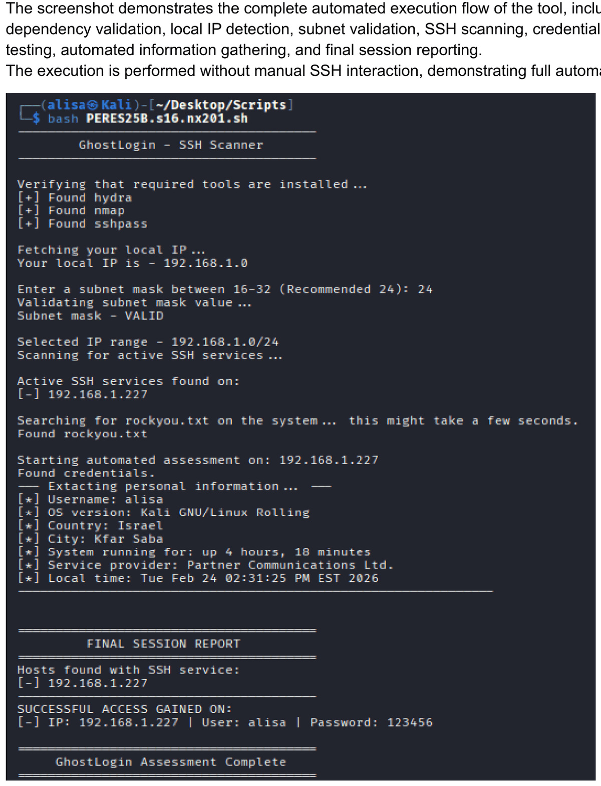

# GhostLogin — Automated SSH Exposure & Credential Assessment

> A Bash tool that scans an internal subnet for hosts exposing SSH, performs controlled authentication testing against discovered hosts, and runs non-interactive post-access information-gathering commands on a successful login.

**Context:** Cybersecurity specialization project — Network Research module (Cyberium Arena / ThinkCyber) · **Author:** Alisiya Rabinovich · **Language:** Bash

---

## Overview

GhostLogin automates an SSH-focused assessment flow: it detects the local network, scans a user-defined subnet for hosts with port 22 open, tests common usernames against a password list, and — when a login succeeds — runs a fixed set of read-only commands over SSH without opening an interactive shell. It finishes with a session report listing hosts found and which logins succeeded.

The design aim is to keep routine user interaction minimal, though some runs require additional choices (see limitations).

## Problem & objectives

- Automate SSH discovery, credential testing, and post-access verification across a subnet.
- Keep the remote actions non-interactive (no manual SSH session).
- Produce a clear report of exposed SSH hosts and successful logins.

## Technologies used

| Tool | Role |
|------|------|
| **Nmap** | Scans the subnet for hosts with port 22 open (`-p 22 --open`) |
| **Hydra** | Tests common usernames against the selected password list, stopping at the first success per host |
| **sshpass** | Passes the discovered password non-interactively to run post-access commands |
| **Bash** | Input validation, wordlist logic, orchestration, reporting |

## Key features

- **Automatic local-network detection** — resolves the host's own IP to build the target range.
- **Subnet-mask input with validation** — prompts for a mask (16–32, 24 recommended), strips spaces, range-checks it, and re-prompts until valid.
- **SSH-focused discovery** — Nmap scans the CIDR range for port 22 and stores only hosts with SSH open.
- **Controlled credential testing** — Hydra tries a small set of usernames (the current user via `whoami`, plus `root`, `admin`, `user`) against the chosen list, non-interactively, stopping at the first success per host.
- **Non-interactive post-access gathering** — on success, `sshpass` runs a fixed set of read-only commands over SSH.
- **Session report** — lists hosts with SSH open and the successful logins (IP, username, password discovered in the lab).

## Operational workflow

1. **Dependency check** — verifies `hydra`, `nmap`, and `sshpass`; offers to install any that are missing.
2. **Local IP detection** — resolves the host's IP to build the range.
3. **Subnet input & validation** — prompts for the mask and re-asks until valid.
4. **SSH scanning** — Nmap scans the range on port 22; only hosts with SSH open become targets.
5. **Wordlist selection** — see the wordlist note below.
6. **Authentication testing** — Hydra tries the username set against the list, first-success-per-host.
7. **Post-access gathering** — `sshpass` runs the fixed command set over SSH.
8. **Final report** — SSH hosts found and which ones were accessed.

## Post-access information gathered

On a successful login the script runs these read-only commands over SSH (no interactive shell, no file writes):

- current user (`whoami`), OS version (`lsb_release` / `/etc/issue`), system uptime (`uptime -p`), and local time (`date`);
- approximate country, city, and service provider, retrieved by the **remote host** calling the external service `ipapi.co`.

## Technical decisions & limitations

Accurate descriptions of the implementation:

- **The workflow is not always a single input.** User interaction is minimal on the happy path (just the subnet mask), but additional prompts appear when a required tool is missing (install yes/no), when `rockyou.txt` is not found (download yes/no, or fall back to a built-in list), or when the subnet mask is invalid (re-prompt).
- **The 1,100-entry cap applies only to a *local* `rockyou.txt`.** When an existing `rockyou.txt` is found on the system, the script uses only its first 1,100 lines to keep the test bounded. If `rockyou.txt` is instead **downloaded**, it is used in full (no cap); the small built-in fallback list is used as-is.
- **SSH host-key verification is bypassed.** Post-access commands run with `StrictHostKeyChecking=no`, which disables host-key verification so the flow stays non-interactive. This is acceptable only in a controlled lab: in general it removes a protection against man-in-the-middle interception and connecting to an unexpected host.
- **Location/provider data describes an IP, not necessarily a place.** Country/city/provider come from `ipapi.co` run on the remote host and reflect that host's public IP geolocation, which can be inaccurate and may not represent the machine's actual physical location.
- **Cleanup is partial.** The temporary password file used for the built-in list (`/tmp/passwords.txt`) is removed after use, and a truncated local wordlist (`/tmp/rockyou_limited.txt`) is removed at the end. A `rockyou.txt` **downloaded** into the current directory is **not** removed by the script. A connection timeout (`ConnectTimeout=5`) is set to avoid hanging on unreachable hosts.

## Requirements & Execution

**Environment.** Linux, developed and tested on **Kali Linux**. Any Debian-based distribution with the tools below should work.

**Dependencies (from the source).** `hydra`, `nmap`, and `sshpass`. On startup the script checks for each and offers to install any that are missing. Optionally `rockyou.txt` — the script can locate it on the system, download it, or fall back to a small built-in list.

**Root privileges — not required to start.** Unlike CHECKER and VULNER, GhostLogin has **no root check** and is designed to run as a normal user. Its SSH scan (`nmap -p 22`), credential testing, and `sshpass` post-access commands do not require elevation. The script therefore uses its normal (non-`-sS`) Nmap scan.

**Execution command:**

```bash
bash ghostlogin.sh
```

Enter a subnet mask when prompted (24 is recommended). The script then handles discovery, credential testing, post-access gathering, and the final report.

**When elevated privileges may be requested.** Elevation is only involved if a required tool is **missing**: the dependency installer calls `sudo apt install …`, which will prompt for a password at that point. Downloading `rockyou.txt` (if you choose to) writes to the current directory and does not need root. If all tools are already present (as on Kali), the whole run proceeds without `sudo`.

**Before running.** Review the source before executing it, especially if you choose to install dependencies with elevated privileges, and run it **only in an explicitly authorized lab environment** on a network you control.

## Screenshots & demonstrated results

The screenshot below is from the project's own lab run on a private (RFC1918) test network. The successful login (`alisa` on `192.168.1.227`) uses a deliberately weak **lab demonstration** credential, preserved as evidence of functionality.

**Full automated execution flow**


## Project report

The full original project report (cleaned of academic identifiers) is included: [ghostlogin-project-report.pdf](docs/ghostlogin-project-report.pdf).

## Technical and Design Takeaways

- **Designing a hands-off automation flow** — the script chains discovery, credential testing, and post-access gathering so the remote steps run without interactive prompts, using `sshpass` and non-interactive SSH options.
- **Error handling and failure modes** — it anticipates missing tools, a missing wordlist, and unreachable hosts, and provides a path through each (install prompts, download/fallback, connection timeout).
- **Practical troubleshooting of tooling** — details like locating `rockyou.txt` across common directories, capping a large local wordlist, and bypassing host-key prompts reflect hands-on problem-solving with real command-line tools.
- **Reporting** — results are collected into a clear final report distinguishing hosts discovered from hosts successfully accessed.

Beyond the cybersecurity domain, the transferable skills here are the ones that make any automation reliable: designing an end-to-end flow that runs unattended, anticipating and handling failure conditions gracefully, troubleshooting real tool behavior, and summarizing outcomes clearly.

## Educational use & authorization

This tool was built and run in an **authorized educational laboratory environment**. Credential brute-forcing, bypassing host-key verification, and running commands on a remote host are techniques that are illegal against systems you are not explicitly authorized to test. Scope and automation choices here are technical conveniences, **not** authorization. Use only in an isolated lab you control.
