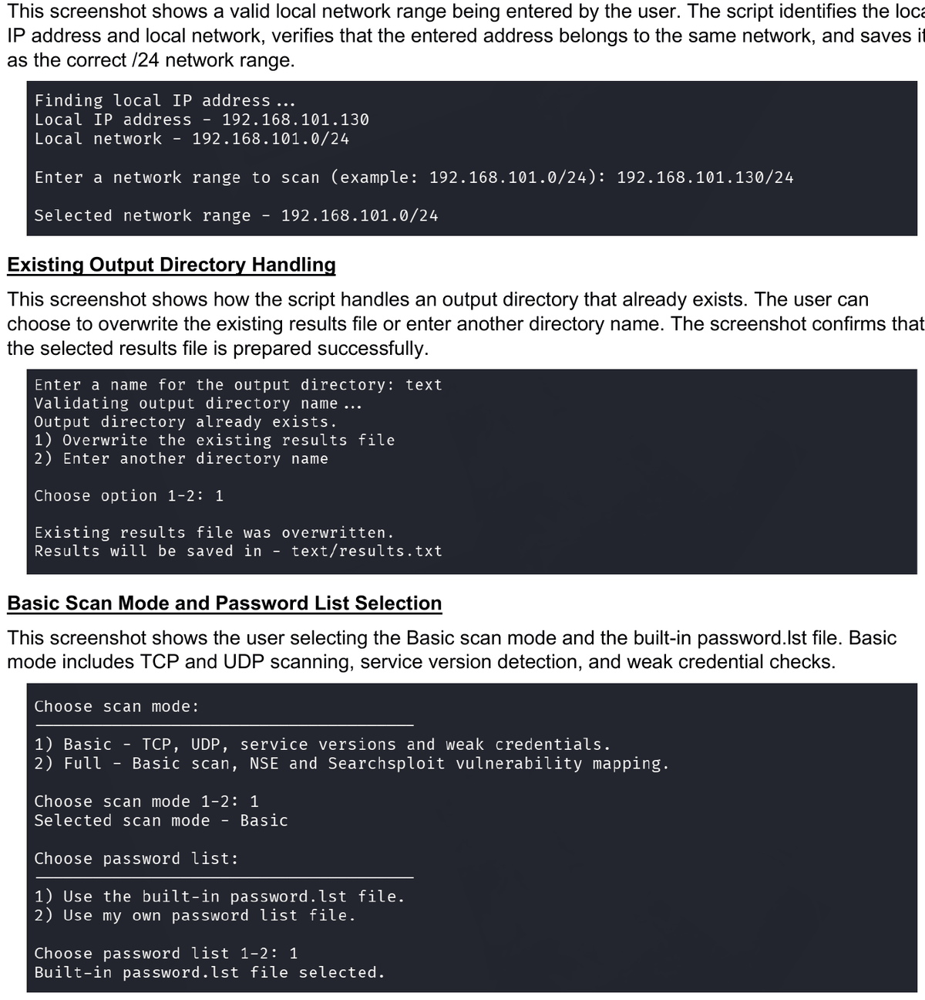
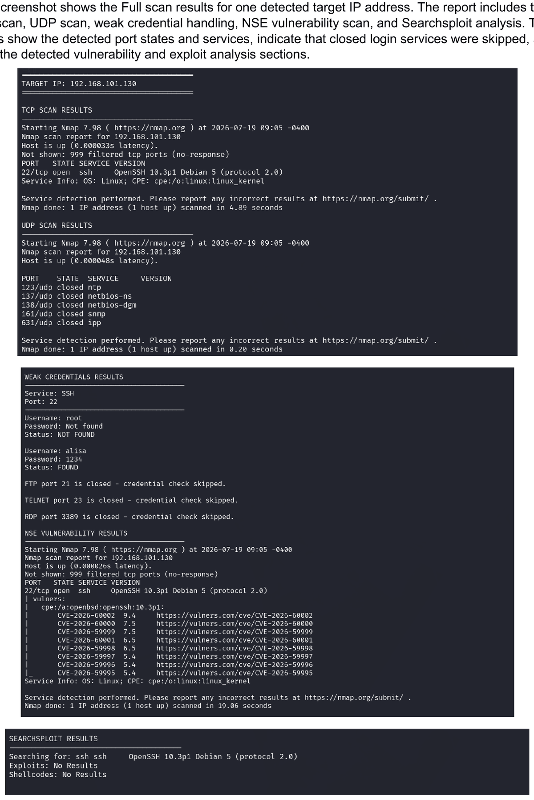
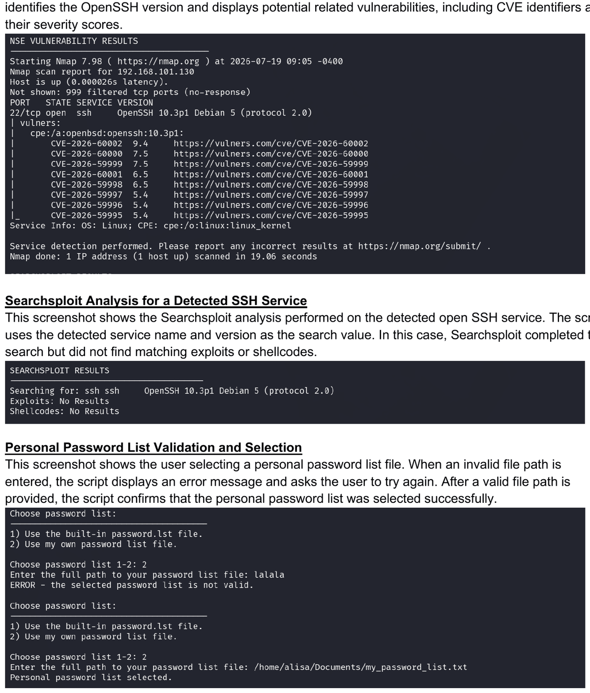
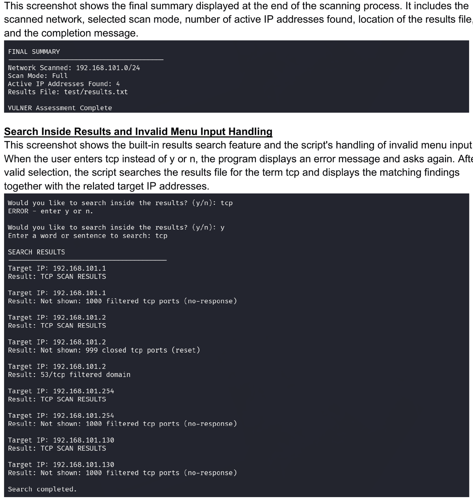
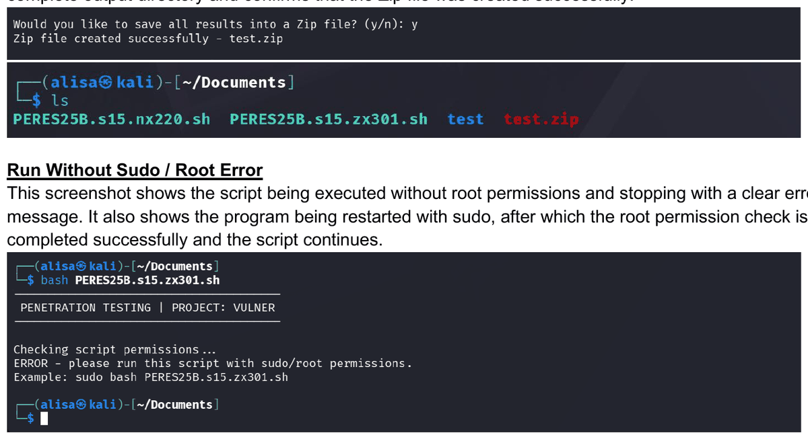

# VULNER — Automated Network Scanning & Vulnerability Mapping

> A Bash tool that scans a local `/24` network, discovers active hosts, performs service and weak-credential checks, and — in Full mode — maps potential vulnerabilities, saving all findings to a structured, searchable report that can be exported as a Zip archive.

**Context:** Cybersecurity specialization project — Penetration Testing module (Cyberium Arena / ThinkCyber) · **Author:** Alisiya Rabinovich · **Language:** Bash

---

## Overview

VULNER automates the repeatable stages of a local network assessment. The user supplies a network range and an output directory; the script validates the input, discovers active hosts, and runs the selected set of checks against **every** detected host in sequence, writing all output to a structured `results.txt`. At the end it displays the report, lets the user search inside it, and can compress the whole output directory into a Zip file.

## Problem & objectives

- Automate host discovery, service/version detection, weak-credential checks, and (optionally) vulnerability mapping so they run the same way on every target.
- Keep all findings in one structured, searchable report.
- Make the depth of the assessment a deliberate choice (Basic vs. Full).

## Technologies used

| Tool | Role |
|------|------|
| **Nmap** | Host discovery, TCP scan with service/version detection, UDP scan, and NSE vulnerability scripts |
| **Hydra** | Weak-credential testing for SSH, FTP, TELNET, and RDP |
| **Searchsploit** (`exploitdb`) | Maps detected service/version strings to known exploit references (Full mode) |
| **Zip** | Compresses the output directory for export |
| **Bash** | Input validation, orchestration, structured reporting, in-report search |

## Scan modes

The user chooses the depth up front:

| Mode | What it runs |
|------|--------------|
| **Basic** | TCP SYN scan with service/version detection (`-sS -sV`, top 1000 ports), a controlled UDP scan (top 5 ports, limited retries and host timeout), and weak-credential checks for SSH/FTP/TELNET/RDP **only where the relevant port is open**. |
| **Full** | Everything in Basic **plus** an Nmap Scripting Engine vulnerability scan (`--script vuln`) and a Searchsploit lookup for each detected open TCP service/version. |

Both modes run automatically against every active host, with no extra input between targets.

## Key features

- **Guided, validated input** — IPv4 format, a required `/24` CIDR, and a check that the entered range matches the host's own local network; the output-directory name is validated and existing directories are handled safely (overwrite or rename).
- **Automatic host discovery** — Nmap ping-sweeps the range and stores every active host.
- **Service & version detection** — TCP (top 1000) and a bounded UDP scan with Nmap version fingerprinting.
- **Weak-credential testing** — Hydra against SSH, FTP, TELNET, and RDP, each only when its port is open, with a clear `FOUND` / `NOT FOUND` / `TEST ERROR` status per username. RDP is additionally skipped if the installed Hydra build lacks the `rdp` module.
- **Built-in or custom password list** — see the note below on how the built-in list works.
- **Vulnerability mapping (Full mode)** — NSE `vuln` scripts and Searchsploit references.
- **Structured, searchable output** — all findings in `results.txt`, with a built-in keyword search that reports matches alongside their target IP.
- **Zip export** — the complete output directory can be compressed into a `.zip`.

## Operational workflow

1. **Root check** — requires root (SYN/UDP scanning and the security tools need it).
2. **Dependency check** — verifies Nmap, Hydra, and Zip; also Searchsploit if Full mode is chosen.
3. **Network input & validation** — auto-detects the local IP, then validates the entered `/24` range against it.
4. **Output directory setup** — validates the name; creates the directory and `results.txt`, or handles an existing one.
5. **Mode & password-list selection** — Basic or Full; built-in or custom list.
6. **Username collection & host discovery** — collects local usernames from `/etc/passwd`; Nmap discovers active hosts.
7. **Automated per-target scanning** — each host runs through the selected stages in sequence.
8. **Report, search, export** — display the full report, search it by keyword, and optionally export to Zip.

## Technical decisions & limitations

Accurate descriptions of the implementation:

- **The built-in password list is generated at runtime, not bundled.** When the user selects the built-in option, the script writes a short weak-password list to a temporary file (`/tmp/password.lst`) during execution and removes it on exit via an `EXIT` trap. There is no `password.lst` shipped with the project. A user-supplied list is used as-is after an existence/readability/non-empty check.
- **NSE and Searchsploit results are indicators, not confirmed exploits.** The NSE `vuln` output and Searchsploit references identify *potential* vulnerabilities and *candidate* exploit entries based on detected service/version strings. They are leads for further manual verification — the script does **not** confirm, validate, or exploit any of them.
- **The `/24` local-network restriction is a scope limitation, not authorization.** Refusing ranges that don't match the host's own `/24` keeps the tool pointed at the intended lab segment; it does not grant permission to scan anything.
- **UDP scanning is intentionally bounded** (top 5 ports, `--max-retries 1`, `--host-timeout 30s`) to avoid slow or hanging scans; it is therefore not exhaustive.
- **Credential coverage** depends on both the open port and Hydra's compiled modules (e.g. RDP is skipped when unsupported), so a "skipped" result is not the same as "no weak credentials."

## Requirements & Execution

**Environment.** Linux, developed and tested on **Kali Linux**. Any Debian-based distribution with the tools below should work.

**Dependencies (from the source).** `nmap`, `hydra`, and `zip` are always required; `searchsploit` (from the `exploitdb` package) is additionally required when **Full** mode is selected. The script checks for each and offers to install any missing tool via `apt`.

**Root privileges — required.** VULNER **must** run as root: `check_root` exits immediately if the effective user is not root. Elevation is needed for the TCP SYN scan (`-sS`) and UDP scan, which require raw-socket access.

**Execution command:**

```bash
sudo bash vulner.sh
```

The script prompts for a network range and output directory, lets you choose Basic or Full mode and a password list, then scans every detected host automatically. When it finishes you can search the report and export it to a Zip file.

**Elevated-privilege behavior to be aware of.** Run with `sudo`, this script may **install packages** (`apt install`) and performs **privileged network scanning** (raw TCP/UDP scans, service probing, and — in Full mode — NSE vulnerability scripts) against every host it discovers in the entered `/24` range. Review the source before running it with `sudo`, and run it **only in an explicitly authorized lab environment** on a network you control.

## Screenshots & demonstrated results

All screenshots are from the project's own lab runs on a private (RFC1918) test network.

**Network validation and scan-mode selection**


**Full scan results for a detected target**


**NSE vulnerability findings and Searchsploit lookup**


**Final report and in-report search**


**Zip export of the results**


## Project report

The full original project report (cleaned of academic identifiers) is included: [vulner-project-report.pdf](docs/vulner-project-report.pdf).

## Technical and Design Takeaways

- **Workflow and process design** — the assessment is decomposed into clearly ordered stages (discovery → TCP → UDP → credentials → optional NSE/Searchsploit), each in its own function, driven by a Basic/Full mode switch.
- **Rigorous input validation** — IPv4 structure, CIDR, local-network matching, directory-name rules, and safe handling of existing output are all validated before any scanning begins.
- **Integrating multiple security tools** — Nmap, Hydra, Searchsploit, and Zip are combined behind one automated flow, with each tool's output normalized into a single structured report.
- **Structured output with retrieval and export** — findings are written to `results.txt` with a built-in search and a Zip export, turning raw tool output into a reviewable, shareable artifact.

Beyond the cybersecurity domain, the transferable skills here are directly applicable to systems analysis and process design: modeling a multi-stage workflow with a mode switch, enforcing data validation before processing, integrating several tools into one automated pipeline, and designing output that is structured, searchable, and easy to hand off.

## Educational use & authorization

This tool was built and run in an **authorized educational laboratory environment**. The `/24` scope restriction and bounded scans are technical controls, **not** authorization. Do not run it against any network you are not explicitly authorized to test. Unauthorized scanning and credential testing are illegal in most jurisdictions.
